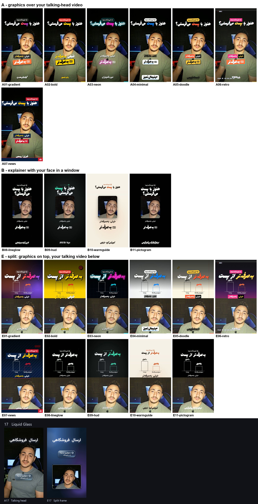

# راهنمای کار با سبک‌ها و ساخت ویدیو

## ساخت یک ریل در استودیو

۱. در «هدف و مخاطب»، پیام اصلی و اقدام بیننده را ثبت کنید. موارد باز در بریف مشخص می‌شوند.
۲. در «سناریو و فایل‌ها»، متن را به نما تبدیل کنید یا گفتار فایل را تحلیل کنید. اگر فقط موضوع دارید، گزینهٔ «سه نمای پیشنهادی» را فعال کنید و برای هر نما متن یا تصویر تعیین کنید.
۳. در «استوری‌بورد و سبک»، مقصود و تصویر هر نما را بازبینی کنید. روی اسکرین‌شات بزنید تا نقطهٔ تمرکز انتخاب شود. انتخاب دستی نوع نما اولویت دارد. نمودار به حداقل دو مقدار عددی و یک واحد نیاز دارد. زمان‌های ورودی نسبت به ابتدای گفتار هستند.
۴. در «بازبینی و تحویل»، بریف خلاقه، شات‌لیست و مشخصات فنی را مرور کنید. شات‌لیست زمان نهایی شامل اینترو و اوترو را نشان می‌دهد. موتور پیش‌فرض GSAP ویدیوی عمودی ۱۰۸۰×۱۹۲۰ می‌سازد. قاب کنار فرم طرح تقریبی است. برای بررسی تصویر واقعی از «رندر پیش‌نمایش فریم‌ها» استفاده کنید.

با هر ذخیره، فایل‌های `ai-director-brief.md`، `shot-list.md`، `execution.json` و `plan.json` در پوشهٔ همان پروژه تولید می‌شوند.


این راهنما مسیر انتخاب ظاهر از [گالری](gallery/README.md) تا خروجی MP4 را توضیح می‌دهد. عبارت «به سبک ... ادیت بزن» درخواست از دستیار است؛ در خط فرمان، شناسهٔ سبک و پلن یا Composition را به موتور می‌دهی.

## ۱. سبک و شکل نمایش را انتخاب کن




| حرف روی عکس | کاربرد | مسیر اجرا |
|---|---|---|
| A | گرافیک روی ویدیوی چهره | Studio GSAP Engine / Plan Engine (`overlay`) |
| B | چهره داخل پنجرهٔ موشن | Studio GSAP Engine (`explainer` + `footage`) |
| C | موشن تمام‌صفحه روی گفتار | Studio GSAP Engine (`explainer`) |
| E | تصویر چهره و موشن در قاب تقسیم‌شده | Studio GSAP Engine (Split `E`) |
| D | صحنه‌پردازی سه‌بعدی WebGL | Studio `Three.js + GSAP 3.12` |

شمارهٔ عکس ظاهر را نشان می‌دهد؛ برای مثال [A04](gallery/A04-minimal.jpg) و [C04](gallery/C04-minimal.jpg) هر دو مینیمال‌اند اما چیدمان متفاوت دارند. عکس‌های گالری **مرجع بصری** هستند. کد سبک‌ها در [پریست‌ها](assets/styles.json)، [موتور GSAP استودیو](studio/gsap_renderer.js)، [موتور پلن](assets/engine.html) و [نمونه پلن‌ها](examples) قرار دارد. از دستیار بخواه سبک و چیدمان عکس را روی ویدیوی خودت پیاده کند؛ عکس را جای فریم ویدیوی تازه استفاده نکن.

موتور استودیو شامل ۲۷ شناسه در `assets/styles.json` و ۶۷ سیستم طراحی مرجع است؛ [فهرست عبارت‌ها](references/commands-fa.md#درخواست-با-زبان-طبیعی) همه را دارد. نمونه‌های سه‌بعدی D12 تا D16 در گالری:

| عکس | ظاهر | الگوی معادل در استودیو |
|---|---|---|
| [D12](gallery/D12-3d-pop.jpg) | پاپ سه‌بعدی | `three-3d-showcase` + `word-pop` |
| [D13](gallery/D13-3d-premium.jpg) | سه‌بعدی پریمیوم | `three-3d-showcase` + `depth-peek` |
| [D14](gallery/D14-remotion-minimal-bw.jpg) | مینیمال سیاه‌وسفید | `clean-spotlight` |
| [D15](gallery/D15-remotion-blueprint.jpg) | نقشه‌کشی و نمودار | `d3-chart` + `rough-sketch` |
| [D16](gallery/D16-remotion-neon-lineart.jpg) | لاین‌آرت نئونی | `cursor-guided-ui` |

## ۲. درخواست دقیق به دستیار بده

```text
«E:\camtasia\optimised video\opt.mp4» را به سبک نیاس ادیت بزن؛ A روی چهره و C برای توضیح‌ها.
عکس E10 گالری را به‌عنوان مرجع قاب بگیر و موشن بالا، چهره پایین باشد.
اسکرین‌شات محصول را سه‌بعدی با Three.js و ترکینگ موس نمایش بده و زمان‌ها را با گفتار هماهنگ کن.
اسکرین‌شات‌های review را در بخش نظرها و support را در بخش پشتیبانی نمایش بده.
از ۲۷ تا پایان جملهٔ پشتیبانی، تصویر گوینده را با موشن کامل جایگزین کن.
نسخهٔ کامل، پیش‌نمایش بخش اصلاح‌شده و کاور را تحویل بده.
```

فایل، سبک، محدودهٔ زمانی، جای چهره، شاهد واقعی، زیرنویس، صدا و خروجی را می‌توانی در یک درخواست ترکیب کنی. [کتابخانهٔ فرمان‌های زبان طبیعی](references/commands-fa.md) نمونه‌های بیشتر و جدول نگاشت سبک را دارد.

## ۳. با موتور پلن ویدیو بساز

پیش‌نیازها: Python، Node.js، ffmpeg/ffprobe و Chrome یا Edge. از ریشهٔ همین پروژه در PowerShell:

```powershell
python scripts/setup.py --skip-model
python scripts/analyze.py "E:\camtasia\optimised video\opt.mp4" "E:\camtasia\optimised video\opt-edit" --lang fa
```

پس از تحلیل، در پوشهٔ کار `beats.md` با «جمله → مفهوم → تصویر → حرکت → زمان» و `plan.json` بساز. از [نمونهٔ نیاس](examples/plan.nias.json)، [کات‌اوی](examples/plan.cutaway.json) یا [موشن توضیحی](examples/plan.explainer.json) شروع کن؛ مسیرها، متن و زمان‌های مثال را عوض کن. `style: "nias"` ظاهر نیاس را انتخاب می‌کند، `mode: "overlay"` تصویر اصلی را نگه می‌دارد و `mode: "explainer"` صحنهٔ گرافیکی می‌سازد. برای پنجرهٔ چهره، المان `footage` اضافه کن. [راهنمای اجزای پلن](references/components.md) و [مسیر فنی](references/engine-workflow.md) را ببین.

```powershell
node scripts/render.js "E:\camtasia\optimised video\opt-edit\plan.json" check --strict
node scripts/render.js "E:\camtasia\optimised video\opt-edit\plan.json" preview 1 27 36 97
node scripts/render.js "E:\camtasia\optimised video\opt-edit\plan.json" full
python scripts/compose.py "E:\camtasia\optimised video\opt-edit\plan.json" --out "E:\camtasia\optimised video\opt-edit-final.mp4"
```

زمان‌های پیش‌نمایش نمونه‌اند. `check` خطاهای پلن را می‌گوید؛ `preview` تصویرهای کلیدی می‌سازد؛ `full` لایهٔ گرافیک را تولید می‌کند؛ `compose` تصویر و صدا را ترکیب می‌کند. برای کاور، `node scripts/render.js PLAN cover T` را اجرا کن. خروجی را با [چک‌لیست انتشار](references/release.md) بازبینی کن.

## ۴. با استودیو وب و موتور GSAP + Three.js ویدیو بساز

برای کنترل کامل بصری و رندر مستقیم `1080×1920 @ 30fps` با فونت‌های واقعی فارسی، ترکینگ موس منحنی، ماکاپ سه‌بعدی WebGL (`Three.js`)، انیمیشن‌های `Lottie`، خط‌کشی `Rough.js` و نمودارهای `D3`:

```powershell
python studio/server.py
# یا رندر مستقیم خط فرمان از پوشه پروژه استودیو:
node studio/gsap_renderer.js "studio/projects/<project_id>" check
node studio/gsap_renderer.js "studio/projects/<project_id>" preview
node studio/gsap_renderer.js "studio/projects/<project_id>" full
```

استودیو در آدرس `http://127.0.0.1:8765` پیش‌نمایش زنده دارد و خروجی نهایی را در `final.mp4` همراه با شیت پیش‌نمایش `build/preview.jpg` تولید می‌کند.

## ۵. خروجی را بازبینی کن

ویدیوی ورودی را بازنویسی نکن. در MP4 نهایی، هماهنگی المان با واژه، خوانایی زیرنویس، درست‌بودن نام‌ها و نشانی‌ها، نمایش شاهدهای واقعی، خروج از قاب امن و میکس گفتار/موسیقی را بررسی کن. تصاویر گالری و پلن‌های نمونه جای دادهٔ واقعی کاربر را نمی‌گیرند.
