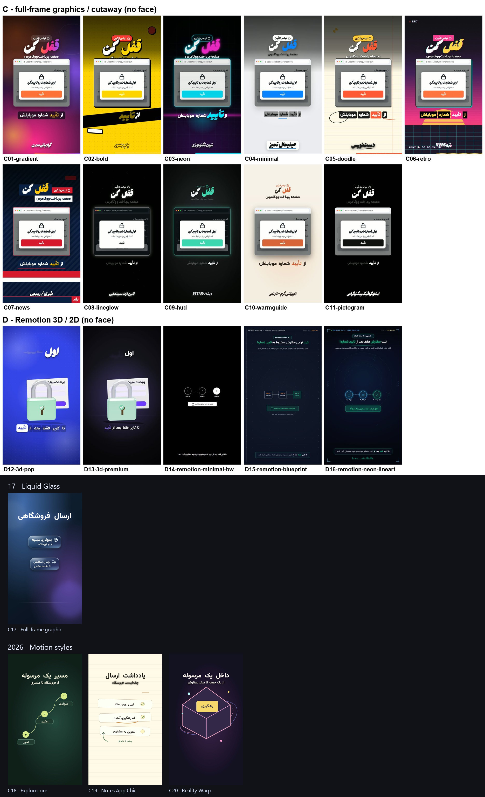

# راهنمای کار با سبک‌ها و ساخت ویدیو

این راهنما مسیر انتخاب ظاهر از [گالری](gallery/README.md) تا خروجی MP4 را توضیح می‌دهد. عبارت «به سبک ... ادیت بزن» درخواست از دستیار است؛ در خط فرمان، شناسهٔ سبک و پلن یا Composition را به موتور می‌دهی.

## ۱. سبک و شکل نمایش را انتخاب کن




| حرف روی عکس | کاربرد | مسیر اجرا |
|---|---|---|
| A | گرافیک روی ویدیوی چهره | Plan Engine: `mode: "overlay"` |
| B | چهره داخل پنجرهٔ موشن | Plan Engine: `mode: "explainer"` + `footage` |
| C | موشن تمام‌صفحه روی گفتار | Plan Engine: `mode: "explainer"` |
| E | تصویر چهره و موشن در قاب تقسیم‌شده | Plan Engine: `mode: "explainer"` + `footage` |
| D | انیمیشن ۲بعدی/سه‌بعدی React | Remotion |

شمارهٔ عکس ظاهر را نشان می‌دهد؛ برای مثال [A04](gallery/A04-minimal.jpg) و [C04](gallery/C04-minimal.jpg) هر دو مینیمال‌اند اما چیدمان متفاوت دارند. عکس‌های گالری **مرجع بصری** هستند. کد A/B/C/E در [پریست‌ها](assets/styles.json)، [موتور](assets/engine.html) و [نمونه پلن‌ها](examples) است. کد D در [Root](templates/remotion/src/Root.tsx) و فایل‌های `templates/remotion/src/` است. از دستیار بخواه سبک و چیدمان عکس را روی ویدیوی خودت پیاده کند؛ عکس را جای فریم ویدیوی تازه استفاده نکن.

Plan Engine شامل ۲۶ شناسه در `assets/styles.json` است؛ [فهرست عبارت‌ها](references/commands-fa.md#درخواست-با-زبان-طبیعی) همه را دارد. برای بعضی شناسه‌ها هنوز عکس گالری ساخته نشده است. نمونه‌های Remotion D12 تا D16 شناسهٔ Plan Engine نیستند:

| عکس | ظاهر | Composition |
|---|---|---|
| [D12](gallery/D12-3d-pop.jpg) | پاپ سه‌بعدی | `Pop3DVideo` |
| [D13](gallery/D13-3d-premium.jpg) | سه‌بعدی پریمیوم | `Premium3DVideo` |
| [D14](gallery/D14-remotion-minimal-bw.jpg) | مینیمال سیاه‌وسفید | `MinimalVideo` |
| [D15](gallery/D15-remotion-blueprint.jpg) | نقشه‌کشی | `InfographicVideo` |
| [D16](gallery/D16-remotion-neon-lineart.jpg) | لاین‌آرت نئونی | `MainVideo` |

## ۲. درخواست دقیق به دستیار بده

```text
«E:\camtasia\optimised video\opt.mp4» را به سبک نیاس ادیت بزن؛ A روی چهره و C برای توضیح‌ها.
عکس E10 گالری را به‌عنوان مرجع قاب بگیر و موشن بالا، چهره پایین باشد.
از کد D13 در templates/remotion استفاده کن و داستان و زمان‌ها را با گفتار این فایل بازنویسی کن.
اسکرین‌شات‌های review را در بخش نظرها و support را در بخش پشتیبانی نمایش بده.
از ۲۷ تا پایان جملهٔ پشتیبانی، تصویر گوینده را با موشن کامل جایگزین کن.
نسخهٔ کامل، پیش‌نمایش بخش اصلاح‌شده و کاور را تحویل بده.
```

فایل، سبک، محدودهٔ زمانی، جای چهره، شاهد واقعی، زیرنویس، صدا و خروجی را می‌توانی در یک درخواست ترکیب کنی. [کتابخانهٔ فرمان‌های زبان طبیعی](references/commands-fa.md) نمونه‌های بیشتر و جدول نگاشت سبک را دارد.

## ۳. با موتور پلن ویدیو بساز

پیش‌نیازها: Python، Node.js، ffmpeg/ffprobe و Chrome یا Edge. از ریشهٔ همین پروژه در PowerShell:

```powershell
python scripts/setup.py --skip-model
python scripts/analyze.py "E:\camtasia\optimised video\opt.mp4" "E:\camtasia\optimised video\opt-edit" --lang fa
```

پس از تحلیل، در پوشهٔ کار `beats.md` با «جمله → مفهوم → تصویر → حرکت → زمان» و `plan.json` بساز. از [نمونهٔ نیاس](examples/plan.nias.json)، [کات‌اوی](examples/plan.cutaway.json) یا [موشن توضیحی](examples/plan.explainer.json) شروع کن؛ مسیرها، متن و زمان‌های مثال را عوض کن. `style: "nias"` ظاهر نیاس را انتخاب می‌کند، `mode: "overlay"` تصویر اصلی را نگه می‌دارد و `mode: "explainer"` صحنهٔ گرافیکی می‌سازد. برای پنجرهٔ چهره، المان `footage` اضافه کن. [راهنمای اجزای پلن](references/components.md) و [مسیر فنی](references/engine-workflow.md) را ببین.

```powershell
node scripts/render.js "E:\camtasia\optimised video\opt-edit\plan.json" check --strict
node scripts/render.js "E:\camtasia\optimised video\opt-edit\plan.json" preview 1 27 36 97
node scripts/render.js "E:\camtasia\optimised video\opt-edit\plan.json" full
python scripts/compose.py "E:\camtasia\optimised video\opt-edit\plan.json" --out "E:\camtasia\optimised video\opt-edit-final.mp4"
```

زمان‌های پیش‌نمایش نمونه‌اند. `check` خطاهای پلن را می‌گوید؛ `preview` تصویرهای کلیدی می‌سازد؛ `full` لایهٔ گرافیک را تولید می‌کند؛ `compose` تصویر و صدا را ترکیب می‌کند. برای کاور، `node scripts/render.js PLAN cover T` را اجرا کن. خروجی را با [چک‌لیست انتشار](references/release.md) بازبینی کن.

## ۴. با Remotion ویدیو بساز

Remotion پروژهٔ React است و `templates/remotion/` یک داستان نمونه دارد. `style: "3d-premium"` در `plan.json` کار نمی‌کند؛ یکی از Compositionهای بالا را انتخاب کن. اسکریپت شروع، قالب را در پوشهٔ کار کپی می‌کند، صدا را به `public/audio.mp3` می‌برد و با `--install` وابستگی‌ها را نصب می‌کند:

```powershell
python scripts/remotion_init.py "E:\camtasia\optimised video\new-reel" --audio "E:\camtasia\optimised video\opt.mp4" --install
Set-Location "E:\camtasia\optimised video\new-reel\remotion"
npm run dev
```

Studio در مرورگر پیش‌نمایش تعاملی دارد. در `src/Root.tsx`، شناسه، مدت، fps و اندازهٔ هر Composition ثبت شده است. برای ویدیوی تازه، زمان/واژه‌ها را در `src/pop3d/timing.ts`، صحنه‌های سه‌بعدی را در `src/pop3d/World.tsx` و `Overlay.tsx`، یا صحنه‌های ۲بعدی را در پوشهٔ `src/minimal`، `src/infographic` و `src/scenes` با گفتار خودت هماهنگ کن. فایل‌های رسانه‌ای را در `public/` قرار بده. اگر فونت شخصی در `assets/fonts/user/` وجود نداشته باشد، اسکریپت هشدار می‌دهد؛ فونت مجاز خودت را جایگزین کن. این قالب با زمان‌بندی ثابت نمونه کار می‌کند و بدون بازنویسی داستان برای ورودی تازه مناسب نیست.

```powershell
npm run lint
npx remotion compositions
npx remotion still Premium3DVideo "E:\camtasia\optimised video\new-reel\frame.jpg" --frame=120 --gl=angle
npx remotion render Premium3DVideo "E:\camtasia\optimised video\new-reel\final.mp4" --gl=angle
```

برای صحنهٔ سه‌بعدی ویندوز، `--gl=angle` را امتحان کن؛ اگر GPU در دسترس نیست، `--gl=swangle` گزینهٔ نرم‌افزاری است. برای ۲بعدی معمولاً تنظیم GL لازم نیست. قبل از رندر نهایی، فریم‌های شروع، اوج و پایان هر صحنه را در Studio بررسی کن. جزئیات در [راهنمای Remotion همین اسکیل](references/remotion-3d.md) و مستند رسمی [Studio](https://www.remotion.dev/docs/studio)، [رندر](https://www.remotion.dev/docs/render) و [GL](https://www.remotion.dev/docs/gl-options) آمده است.

## ۵. خروجی را بازبینی کن

ویدیوی ورودی را بازنویسی نکن. در MP4 نهایی، هماهنگی المان با واژه، خوانایی زیرنویس، درست‌بودن نام‌ها و نشانی‌ها، نمایش شاهدهای واقعی، خروج از قاب امن و میکس گفتار/موسیقی را بررسی کن. تصاویر گالری و پلن‌های نمونه جای دادهٔ واقعی کاربر را نمی‌گیرند.
