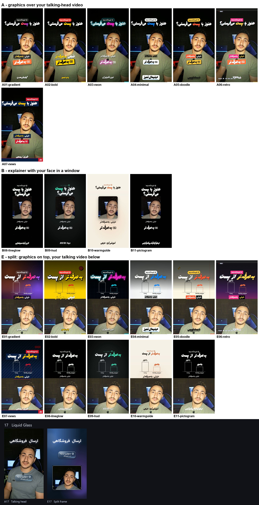
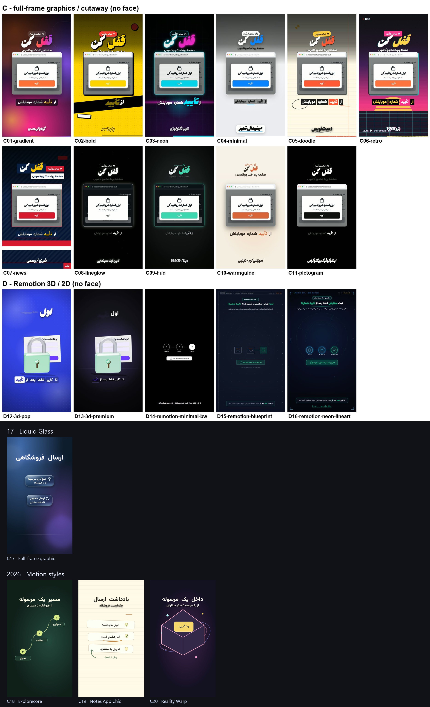

# reel-motion-edit

اسکیل تدوین ریلز فارسی از ایده، گفتار یا فیلم خام. برای ادیت ساده، ویدیو تحویل می‌دهد. برای ریلز آماده انتشار، ویدیو، کاور، کپشن پست و زیرنویس بازبینی‌شدهٔ گفتار را یک‌جا آماده می‌کند.

**شروع از اینجا:** [راهنمای کامل ساخت ویدیو با سبک‌ها و Remotion](GUIDE.md) · [سایت راهنمای محلی](docs/index.html)





نمونهٔ درخواست به دستیار:

```text
این فایل را به سبک نیاس ادیت بزن؛ برای هر مفهوم المان مرتبط بیاور.
به سبک مینیمال ادیت بزن.
به سبک لیکوئید گلس ادیت بزن.
هوشمند ادیت بزن و سبک مناسب خود ویدیو را پیشنهاد بده.
عکس E10 گالری را مرجع چیدمان بگیر: موشن بالا و چهره پایین.
با کد D13 قالب Remotion همین پروژه یک داستان تازه بساز؛ زمان‌ها را با گفتار من هماهنگ کن.
```

مسیر ویدیو را همراه درخواست بده. [فهرست عبارت‌های هر ۲۶ سبک و نمونه‌های اصلاح](references/commands-fa.md#درخواست-با-زبان-طبیعی) مشخص می‌کند هر درخواست به کدام پریست نگاشت می‌شود. عکس‌های `gallery/` فقط نمونهٔ بصری‌اند؛ کد سبک‌های موتور پلن در `assets/styles.json` و `assets/engine.html` و کد سبک‌های Remotion در `templates/remotion/src/` است.

- [مسیر اصلی اسکیل](SKILL.md)
- [راهنمای فارسی تمام فرمان‌ها و گزینه‌ها](references/commands-fa.md)
- [سبک نیاس](references/nias.md) و [نمونه پلن](examples/plan.nias.json)
- [راهنمای فنی موتور](references/engine-workflow.md) و [بازبینی انتشار](references/release.md)
- [پریست‌ها](references/styles.md)، [گالری](gallery/README.md) و [موتور سه‌بعدی](references/remotion-3d.md)

پیش‌نیاز: Python، Node.js، ffmpeg/ffprobe و Chrome یا Edge. از ریشه پروژه:

```powershell
python scripts/setup.py
```

برای نصب به عنوان اسکیل، پوشهٔ پروژه را در محل اسکیل‌های ابزار مورد استفاده قرار بده. متن و کد پروژه تحت مجوز [LICENSE](LICENSE) هستند؛ برای فونت و سایر دارایی‌ها به [اعتبارنامه‌ها](assets/CREDITS.md) مراجعه کن.

سورس سبک شامل کد، راهنما، قالب و دارایی‌های موتور است. ویدیوهای رفرنس، ضبط‌های شخصی، خروجی‌ها و فایل‌های میانی تدوین را داخل بستهٔ اسکیل نگهداری نکن؛ برای هر کار پوشه‌ای کنار ویدیوی ورودی بساز. پوشهٔ محلی `work/` نیز از Git کنار گذاشته شده است. فوتیج‌های `assets/footage/` دارایی قابل‌استفادهٔ موتورند و با ویدیوهای آزمایشی فرق دارند. پاک‌سازی فایل‌های کاری، حجم تاریخچهٔ قدیمی Git را تغییر نمی‌دهد.
